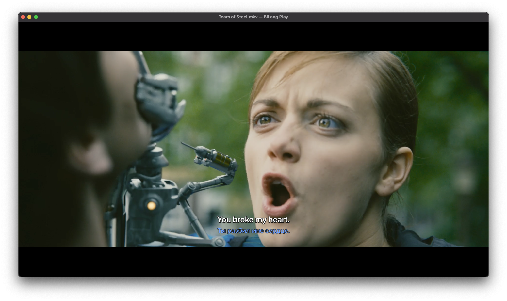
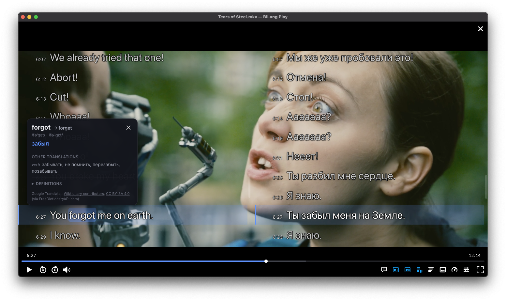

<p align="center"></p>

# BiLang Play

A desktop video player for language learners. Watch your own videos with
subtitles in the language you learn and in your own, pause to see the
transcript, and click any word for its translation and definition.
Make it look the way you read best: style profiles, and fonts, sizes,
colors, outlines, and positions for the subtitles and both transcripts.

**Status: alpha.** Builds are shared for testing; expect rough edges. The
interface is in English only for now; translations will come later. What
changed in each version: [CHANGELOG.md](CHANGELOG.md).

**Vibe-coded.** The app is written almost entirely by AI coding agents
(Claude Code and Codex), directed, tested, and reviewed by its author.

**Download:** [uvlad7.github.io/BiLang-Play](https://uvlad7.github.io/BiLang-Play/)
picks the right package for your system, or take one from
[Releases](https://github.com/uvlad7/BiLang-Play/releases).

| System | Package | Needs |
| --- | --- | --- |
| Windows | `bilangplay-<version>-windows-x64-setup.exe` (installer) or `…-windows-x64.zip` (portable) | Windows 10 or 11, 64-bit |
| macOS | `bilangplay-<version>-macos-arm64.dmg` or `….zip` | A Mac with Apple Silicon (M1 or later) |
| Linux | `bilangplay-<version>-linux-x86_64.AppImage`, `…-linux-amd64.deb`, or `…-linux-x64.tar.gz` | x86-64 with glibc 2.35 or newer (Ubuntu 22.04+, Debian 12+, Fedora 36+) |

The builds are not signed with a paid certificate yet, so Windows and macOS
warn about them once. The steps below get past that.

## Screenshots

Two subtitles while it plays:



On pause, the transcript in both languages, and a word looked up:



More: [paused](screenshots/window-paused.png), and fullscreen:
[playing](screenshots/fullscreen-playing.png), [paused](screenshots/fullscreen-paused.png),
[word](screenshots/fullscreen-word.png). Taken on macOS.

The film is [Tears of Steel](https://mango.blender.org), (CC) Blender
Foundation, [CC BY 3.0](https://creativecommons.org/licenses/by/3.0/):
[the video](https://download.blender.org/demo/movies/ToS/tears_of_steel_1080p.mov.zip),
its [Dolby 5.1 mix](https://download.blender.org/demo/movies/ToS/Surround-TOS_DVDSURROUND-Dolby%205.1.ac3)
as the second audio track, and its
[English](https://download.blender.org/demo/movies/ToS/subtitles/TOS-en.srt) and
[Russian](https://download.blender.org/demo/movies/ToS/subtitles/TOS-ru.srt) subtitles.

## Install

### Windows

**NSIS installer (.exe).** Run `bilangplay-<version>-windows-x64-setup.exe`.
It installs for your user only (no administrator rights), by default into
`%LOCALAPPDATA%\Programs\BiLang Play`, and adds Start menu and desktop
shortcuts.

**Portable app (.zip).** Unzip it anywhere and run `BiLang Play.exe`. On the
first start it offers to add itself to the Start menu and the desktop.

**If Windows blocks it.** Windows marks downloaded files, and unsigned apps
then get "Windows protected your PC" (choose **More info**, then **Run
anyway**) or "The publisher could not be verified" (choose **Run**). To
remove the mark beforehand, right-click the downloaded file, choose
**Properties**, tick **Unblock**, and choose **OK**; for the zip, do it
before unzipping. Or in PowerShell:

```powershell
# The downloaded installer or zip:
Unblock-File "$env:USERPROFILE\Downloads\bilangplay-<version>-windows-x64.zip"
# A folder already unzipped, every file in it:
Get-ChildItem -Recurse "<the unzipped folder>" | Unblock-File
```

Where Smart App Control (Windows 11) blocks unsigned apps, unblocking does
not help; only turning Smart App Control off does.

### macOS

**Disk image (.dmg).** Open `bilangplay-<version>-macos-arm64.dmg` and drag
**BiLang Play** onto **Applications**.

**App (.app in .zip).** Unzip it and move **BiLang Play** to
**Applications**. Started anywhere else, the app offers to move itself
there.

**If macOS blocks it.** On the first start macOS says it cannot verify the
app. Choose **Done**, open **System Settings > Privacy & Security**, scroll
down to the message about BiLang Play, and choose **Open Anyway**. Or remove
the "downloaded from the internet" mark in Terminal:

```sh
# The installed app:
xattr -dr com.apple.quarantine "/Applications/BiLang Play.app"
# Or the zip, before unzipping it:
xattr -d com.apple.quarantine ~/Downloads/bilangplay-<version>-macos-arm64.zip
```

### Linux

**Portable app image (.AppImage).** Make it executable and run it:

```sh
chmod +x bilangplay-<version>-linux-x86_64.AppImage
./bilangplay-<version>-linux-x86_64.AppImage
```

(Or in the file manager: **Properties > Permissions > Allow executing file
as program**.) It needs no `libfuse2`. On the first start it offers to add
itself to the applications menu. On Ubuntu 24.04 and later the first start
shows one `sudo` command that installs an AppArmor profile for it, because
Ubuntu restricts the sandbox the app relies on; run it, then start the app
again.

**Debian/Ubuntu (and their derivatives) package (.deb):**

```sh
sudo apt install ./bilangplay-<version>-linux-amd64.deb
```

It adds BiLang Play to the applications menu itself.

**Portable app (.tar.gz).** Unpack it anywhere and run `./bilangplay` in the
folder. On the first start it offers to add itself to the applications menu.
If it exits with a message about the SUID sandbox helper, either install an
AppArmor profile for it or let the bundled helper run as root, from that
folder:

```sh
sudo chown root:root chrome-sandbox && sudo chmod 4755 chrome-sandbox
```

On Ubuntu 22.04-era desktops, install `zenity` so file pickers open in the
last folder you used.

## Uninstall completely

Quit BiLang Play first. Removing the app leaves your settings and app data,
so a reinstall starts where you left off; the commands under **App data and
settings** remove those too. App data is the recent folders of the file
pickers, the answers to first-start questions, and the player's browsing
data and cache. The system's own recent-files lists are not the app's and
stay.

### Windows

- **Installer:** **Settings > Apps > Installed apps > BiLang Play >
  Uninstall**.
- **Portable zip:** delete the folder. If you let it add its shortcuts,
  remove them too (before deleting the folder, the app's start screen also
  has **Remove from Start menu and desktop**):

  ```powershell
  Remove-Item "$env:APPDATA\Microsoft\Windows\Start Menu\Programs\BiLang Play.lnk"
  Remove-Item "$([Environment]::GetFolderPath('Desktop'))\BiLang Play.lnk"
  ```

App data and settings, in PowerShell:

```powershell
Remove-Item -Recurse -Force "$env:APPDATA\bilangplay"
Remove-Item -Recurse -Force "HKCU:\Software\io.github.uvlad7.bilangplay"
```

### macOS

Move **BiLang Play** to the Trash from wherever you keep it (usually
**Applications**). App data and settings, in Terminal:

```sh
rm -rf ~/Library/"Application Support"/bilangplay
defaults delete io.github.uvlad7.bilangplay 2>/dev/null
rm -f ~/Library/Preferences/io.github.uvlad7.bilangplay*.plist
rm -rf ~/Library/"Saved Application State"/io.github.uvlad7.bilangplay*.savedState
```

### Linux

- **`.deb`:** `sudo apt purge bilangplay` (it removes its AppArmor profile
  and settings schema too).
- **AppImage or `.tar.gz`:** delete the file or the folder. If you added it
  to the applications menu, remove the entry and its icons (before deleting
  it, the app's start screen also has **Remove from applications menu**):

  ```sh
  data="${XDG_DATA_HOME:-$HOME/.local/share}"
  rm -f "$data/applications/bilang-play.desktop"
  find "$data/icons/hicolor" -name 'bilang-play*' -delete
  ```

  If you installed the AppImage's AppArmor profile (Ubuntu 24.04 and
  later):

  ```sh
  sudo apparmor_parser -R /etc/apparmor.d/bilangplay-appimage
  sudo rm /etc/apparmor.d/bilangplay-appimage
  ```

App data and settings (settings live in GSettings, stored by dconf on most
desktops):

```sh
rm -rf "${XDG_CONFIG_HOME:-$HOME/.config}/bilangplay"
dconf reset -f /io/github/uvlad7/bilangplay/
```

If the `dconf` command is not found, run this instead, **before** deleting
the app (`gsettings` needs a file that comes with it):

```sh
# .deb
gsettings reset-recursively io.github.uvlad7.bilangplay:/io/github/uvlad7/bilangplay/

# .tar.gz, from the app's folder (the one with bilangplay in it)
gsettings --schemadir resources/settings-schemas reset-recursively io.github.uvlad7.bilangplay:/io/github/uvlad7/bilangplay/

# AppImage, from the folder it is in (this unpacks a temporary copy)
./bilangplay-<version>-linux-x86_64.AppImage --appimage-extract
gsettings --schemadir squashfs-root/resources/settings-schemas reset-recursively io.github.uvlad7.bilangplay:/io/github/uvlad7/bilangplay/
rm -rf squashfs-root
```

## License

BiLang Play is proprietary software, not open source. Alpha builds are
free, and will stay free. Its license, and the licenses of the open-source
components
it includes, are in **Help > Licenses** and in the `licenses` folder of each
package. The source of the bundled FFmpeg and Opus libraries, and the script
that builds them, are attached to every release as LGPL 2.1 requires.

Word definitions: Wiktionary contributors,
[CC BY-SA 4.0](https://creativecommons.org/licenses/by-sa/4.0/), via
[FreeDictionaryAPI.com](https://freedictionaryapi.com). The video player is
built with [PlayerJS](https://playerjs.com).

Found a problem? [Open an issue](https://github.com/uvlad7/BiLang-Play/issues).
